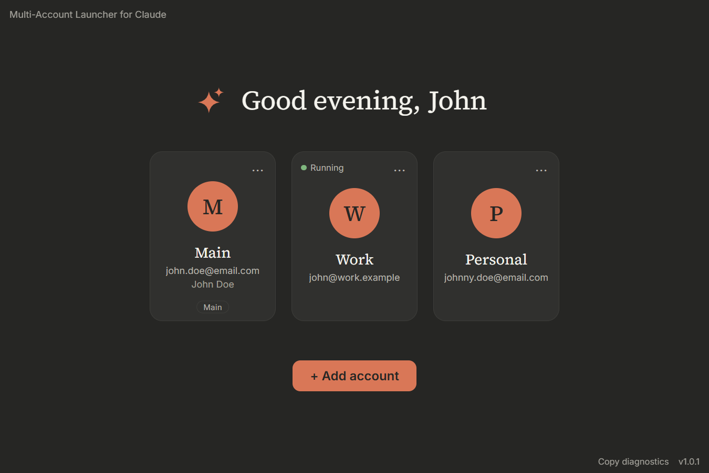

# Multi-Account Launcher for Claude



<p>
  <a href="https://github.com/histuan/Claude-Launcher/releases/latest/download/Claude-Launcher-Setup.exe"></a>
  
  <a href="./LICENSE"></a>
</p>

A small Windows launcher that keeps several Claude accounts signed in at the same time, each one in its own
isolated instance of the official Claude desktop app. Pick an account, click, done. No more signing out and back in.

Works on Windows 10 and 11. Last tested with Claude Desktop 5.1231.0.0 (November 2026).

## Download

The **Download for Windows** button above downloads the latest installer directly. Older versions and release notes
are on the [Releases page](https://github.com/histuan/Claude-Launcher/releases).

## First install

The installer is not signed, so Windows SmartScreen warns you: choose **More info → Run anyway**. It installs for
your user only and does not need administrator rights.

**Before your first sign-in from the launcher, back up your main Claude profile**: with Claude and Claude Code
closed, copy the folder `%LOCALAPPDATA%\Claude-Data\claude_<id>` somewhere else.

## Automatic updates

When a newer version is out, the launcher asks once per start. Nothing is forced:

- **Later** keeps working as usual; an **Update to X** link next to the version (bottom-right) brings the question back.
- **Install** downloads the update with a progress bar, then the launcher closes and installs it. For about 20
  seconds no window shows; then the launcher opens again on the new version.

## Adding an account

Click **Add account** and type a card name, the account's e-mail and, if you like, its account name. The launcher then:

1. closes your main Claude and sets its profile folder aside (a rename, never a delete);
2. opens a blank Claude window where you sign in with your e-mail or with Google (both are tested and work);
3. moves the signed-in profile to the new account and puts your main profile back.

If the launcher is closed in the middle, the next start restores your main profile first.

## Using it

- **Open an account:** click its card. Each account runs in its own Claude window, side by side with the others;
  **● Running** shows which ones are open.
- **Edit details** (card ⋯ menu): card name, e-mail and account name. **Change photo**: a PNG, JPG or WebP picture, shown
  as a circle; **Back to the initial** removes it.
- **Receive memories from…** (card ⋯ menu): a guided assistant that copies Claude's memories from one of your
  accounts to another. You export them in the source account, pick the files to bring, and import them in the
  target account; large exports are split into parts.
- **Copy diagnostics** (bottom-right): puts a short report on the clipboard for bug reports. It has versions,
  account states and recent log lines, but no e-mails, names, tokens or memory text. Paste it into the issue.

## Limitations

- Windows only (10 and 11).
- A sign-out done inside Claude is only seen by the launcher after that account is closed.
- The e-mail and name on each card are typed by you, not detected.
- A Claude Desktop update may break things until the launcher is updated.
- The installer is not signed (see [First install](#first-install)).

## Privacy

The launcher collects no data and sends none. Its only connection is to GitHub, to check for a newer release and,
if you choose **Install**, to download it. Account details, photos and the log stay on your PC; **Copy diagnostics**
only puts its report on your clipboard.

## Unofficial

This is an independent project. It is not affiliated with, endorsed by, or supported by Anthropic.
"Claude" is a trademark of Anthropic. The launcher opens the official Claude desktop app and never modifies it.

## Code signing policy

Status: applied for, pending approval. Until it is approved the installer stays unsigned.

Free code signing provided by [SignPath.io](https://signpath.io), certificate by
[SignPath Foundation](https://signpath.org). Only installers built by this repository's GitHub Actions workflow are
signed; builds made anywhere else are not.

Team roles: the project has a single maintainer, the repository owner ([histuan](https://github.com/histuan)), who is
the only committer, reviewer and approver. Releases are built only by GitHub Actions, never on a personal machine.

## For testers: installing a PR build

[](https://github.com/histuan/Claude-Launcher/actions/workflows/claude-launcher.yml)

Pull Request builds are not on the Releases page; each PR's Actions run has the installer as the artifact
**launcher-installer**. [`scripts/install-latest.ps1`](./scripts/install-latest.ps1) installs it in one step. Save it
(for example in `%USERPROFILE%\Claude-Launcher-tools\`) and run it in PowerShell:

```powershell
powershell -ExecutionPolicy Bypass -File "$env:USERPROFILE\Claude-Launcher-tools\install-latest.ps1"
```

It takes the newest open PR (or `-Pr <number>`), checks that its CI run passed, downloads the installer through
[nightly.link](https://nightly.link) (a third-party service, so no GitHub login is needed), closes the launcher,
installs silently and opens it again. With no open PR it installs the latest release. `-DownloadOnly` only saves
the installer to `%USERPROFILE%\Downloads`.

## Credits

- Built on [Electron](https://www.electronjs.org/), packaged with [electron-builder](https://www.electron.build/),
  updated with `electron-updater`.
- Fonts: [Source Serif 4](https://github.com/adobe-fonts/source-serif) and [Inter](https://rsms.me/inter/), via
  [Fontsource](https://fontsource.org/), under the SIL Open Font License.
- Built with [Claude Code](https://claude.com/claude-code). How it is developed and reviewed:
  [`docs/DEVELOPMENT.md`](./docs/DEVELOPMENT.md).
- How it works, the scope and the history: [`docs/SCOPE.md`](./docs/SCOPE.md), [`docs/WINDOWS.md`](./docs/WINDOWS.md),
  [`CHANGELOG.md`](./CHANGELOG.md).

## License

[MIT](./LICENSE) © 2026 Thiago Uchoa Gomes. You can use, copy, change and share this code freely, including in
other projects, as long as the license notice stays with it. The bundled fonts keep their own license
(SIL Open Font License).
