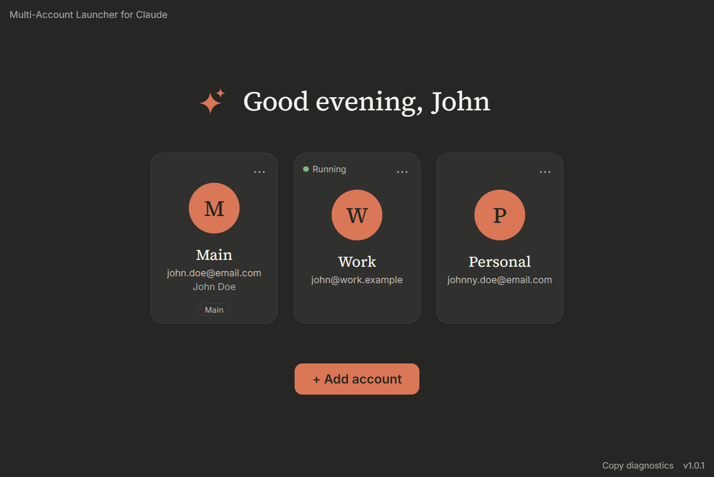

# Multi-Account Launcher for Claude

  
  
  

A small, unofficial Windows launcher that keeps several Claude accounts signed in at the same time, each one in its
own isolated instance of the official Claude desktop app. Pick an account, click, done. No more signing out and back
in. It is not made or supported by Anthropic (see [Unofficial](#unofficial)).

Works on Windows 10 and 11. Last tested with Claude Desktop 5.1231.0.0 (November 2026).

## Download

You need the official Claude desktop app first: install it from [claude.com/download](https://claude.com/download)
and sign in to one account there. That account shows up in the launcher as **Main**. The launcher only opens the
Claude app that is already installed; it does not include it.

The **Download for Windows** button above downloads the latest installer directly. Older versions and release notes
are on the [Releases page](https://github.com/histuan/Claude-Launcher/releases).

## Is it safe?

- **Open source.** All the code is in this repository under the MIT license. The installer on the Releases page is
  built by this repository's GitHub Actions workflow, never on a personal machine.
- **Not signed yet.** The installer has no code-signing certificate, so Edge and Windows warn about it
  ([First install](#first-install)). Free code signing is planned ([Code signing policy](#code-signing-policy)).
- **No administrator rights.** It installs for your Windows user only.
- **It does not change the Claude app.** The launcher starts the installed `Claude.exe` with a separate data folder
  for each account. It never copies, patches or moves Claude's files.
- **One network connection.** It talks to GitHub to check for a newer release and, if you choose **Install**, to
  download it. It makes no request to Claude or Anthropic and sends nothing anywhere else.
- **What it reads on your PC** is listed under [Privacy](#privacy). It never reads cookie values, tokens or chats.
- **Your main Claude profile** is touched only while you add or sign in an account, and only by renaming its
  folder and renaming it back ([Adding an account](#adding-an-account)).
- A security audit of the code is linked in [`docs/DEVELOPMENT.md`](./docs/DEVELOPMENT.md#security-audit); its fixes
  are still planned.

## First install

The installer is not signed, so you get two warnings:

1. **In the browser.** Microsoft Edge may hold the download because the file is not commonly downloaded. In the
   downloads list, open the **⋯** menu next to the file and choose **Keep**, then **Show more → Keep anyway**.
2. **When you run it.** Windows SmartScreen warns you: choose **More info → Run anyway**.

It installs for your user only and does not need administrator rights. After the install, look for
**Multi-Account Launcher for Claude** in the Start menu; no desktop shortcut is created.

**Before your first sign-in from the launcher, back up your main Claude profile**: with Claude and Claude Code
closed, copy the folder `%LOCALAPPDATA%\Claude-Data\claude_<id>` somewhere else. `<id>` is a fixed code from Claude's
package (for example `claude_pzs8sxrjxfjjc`); the folder was about 1 GB on the test PC.

The backup is a precaution. To add an account, the launcher renames that folder to `claude_<id>.launcher-stash`,
lets you sign in on a blank profile, and renames the folder back. It never deletes it. If something stops in the
middle:

- open the launcher again: it finds the unfinished sign-in and offers **Restore main profile**;
- if a sign-in fails, the message shows the folder where your main profile is.

You need the backup only if neither of those brings your profile back. To restore it, close the launcher, Claude and
Claude Code, open `%LOCALAPPDATA%\Claude-Data`, rename any `claude_<id>` folder that is there (so nothing is lost),
and copy your backup back in with the original name.

## Automatic updates

When a newer version is out, the launcher asks once per start. Nothing is forced:

- **Later** keeps working as usual; an **Update to X** link next to the version (bottom-right) brings the question back.
- **Install** downloads the update with a progress bar, then the launcher closes and installs it. For about 20
  seconds no window shows; then the launcher opens again on the new version.

## Adding an account

Click **Add account** and type a card name, the account's e-mail and, if you like, its account name. The launcher then:

1. closes your main Claude and sets its profile folder aside (a rename, never a delete);
2. opens a blank Claude window where you sign in with your e-mail or with Google (both are tested and work);
3. moves the signed-in profile to the new account and puts your main profile back.

If the launcher is closed in the middle, the next start asks first: **Restore main profile** (the default) or continue the sign-in.

## Using it

- **Open an account:** click its card. Each account runs in its own Claude window, side by side with the others;
  **● Running** shows which ones are open.
- **Edit details** (card ⋯ menu): card name, e-mail and account name. **Change photo**: a PNG, JPG or WebP picture, shown
  as a circle; **Back to the initial** removes it.
- **Receive memories from…** (card ⋯ menu): a guided assistant that copies Claude's memories from one of your
  accounts to another. You export them in the source account, pick the files to bring, and import them in the
  target account; large exports are split into parts.
- **Copy diagnostics** (bottom-right): puts a short report on the clipboard for bug reports. It has versions,
  card names, account states and recent log lines, but no e-mails, tokens or memory text. Paste it into the issue.

## Usage limits and Anthropic's terms

The launcher does not change any usage limit. Each account is signed in to the official Claude app on its own and
keeps its own plan and its own limits. The launcher makes no request to Claude or Anthropic, so it has no way to
raise, share or reset a limit.

It is meant for accounts that are already yours, such as a work account and a personal one, on the same PC.

Anthropic's terms apply to every account exactly as they do without the launcher, and following them is up to you.
The [Consumer Terms](https://www.anthropic.com/legal/consumer-terms) (version effective October 8, 2025) forbid
sharing an account's login information with someone else. An account provided by an employer also follows that organization's rules. This project does not
state that any particular use complies with those terms.

## Limitations

- Windows only (10 and 11).
- A sign-out done inside Claude is not detected: the card does not show **Not signed in** for it, because Claude keeps
  the account details on disk after a sign-out.
- The e-mail and name on each card are typed by you, not detected.
- A Claude Desktop update may break things until the launcher is updated.
- The installer is not signed (see [First install](#first-install)).

## Privacy

The launcher collects no data and sends none. Its only connection is to GitHub, to check for a newer release and,
if you choose **Install**, to download it. Account details, photos and the log stay on your PC; **Copy diagnostics**
only puts its report on your clipboard.

What it reads on your PC:

- the installed Claude package and the running `claude.exe` processes (path and command line), to find Claude and
  show **● Running**;
- in each account's profile folder, the key names of `config.json` (never the values) and, on a temporary copy of
  the cookie database that is deleted afterwards, the name, host, expiry date and value length of the claude.ai
  session cookie. That is how a card knows whether it is signed in. Cookie values are never read;
- your Windows display name, for the greeting;
- the picture you pick for a card and the memory export files you pick in **Receive memories from…**.

It does not read your chats.

## Uninstalling

The uninstaller removes the program only. To remove everything:

1. If a sign-in was interrupted, open the launcher once first so it restores your main profile.
2. In the launcher, use **Remove** (card ⋯ menu) on each extra account. This deletes that account's folder under
   `%USERPROFILE%\ClaudeProfiles`. The Claude account itself is not deleted; only its sign-in on this PC is.
3. Uninstall **Multi-Account Launcher for Claude** in Windows Settings → Apps.
4. Delete what is left (paste each path into the File Explorer address bar):
   - `%APPDATA%\claude-launcher`: the launcher's settings, card details, photos and logs;
   - `%USERPROFILE%\ClaudeProfiles`: one folder per extra account that was not removed in step 2, each holding that
     account's signed-in session;
   - `%LOCALAPPDATA%\ClaudeLauncher`, if it exists: a small marker file used during a sign-in.

Leave `%LOCALAPPDATA%\Claude-Data` alone: it belongs to Claude and holds your main profile.

## Unofficial

This is an independent project. It is not affiliated with, endorsed by, or supported by Anthropic.
"Claude" is a trademark of Anthropic. The launcher opens the official Claude desktop app and never modifies it.

## Code signing policy

Status: applied for, pending approval. Until it is approved the installer stays unsigned.

Free code signing provided by [SignPath.io](https://signpath.io), certificate by
[SignPath Foundation](https://signpath.org). Only installers built by this repository's GitHub Actions workflow are
signed; builds made anywhere else are not.

Team roles: the project has a single maintainer, the repository owner ([histuan](https://github.com/histuan)), who is
the only committer, reviewer and approver. Releases are built only by GitHub Actions, never on a personal machine.

## Credits

- Built on [Electron](https://www.electronjs.org/), packaged with [electron-builder](https://www.electron.build/),
  updated with `electron-updater`.
- Fonts: [Source Serif 4](https://github.com/adobe-fonts/source-serif) and [Inter](https://rsms.me/inter/), via
  [Fontsource](https://fontsource.org/), under the SIL Open Font License.
- Built with [Claude Code](https://claude.com/claude-code). How it is developed and reviewed, and how to install a
  Pull Request build for testing: [`docs/DEVELOPMENT.md`](./docs/DEVELOPMENT.md).
- How it works, the scope and the history: [`docs/SCOPE.md`](./docs/SCOPE.md), [`docs/WINDOWS.md`](./docs/WINDOWS.md),
  [`CHANGELOG.md`](./CHANGELOG.md).

## License

[MIT](./LICENSE) © 2026 Thiago Uchoa Gomes. You can use, copy, change and share this code freely, including in
other projects, as long as the license notice stays with it. The bundled fonts keep their own license
(SIL Open Font License).
